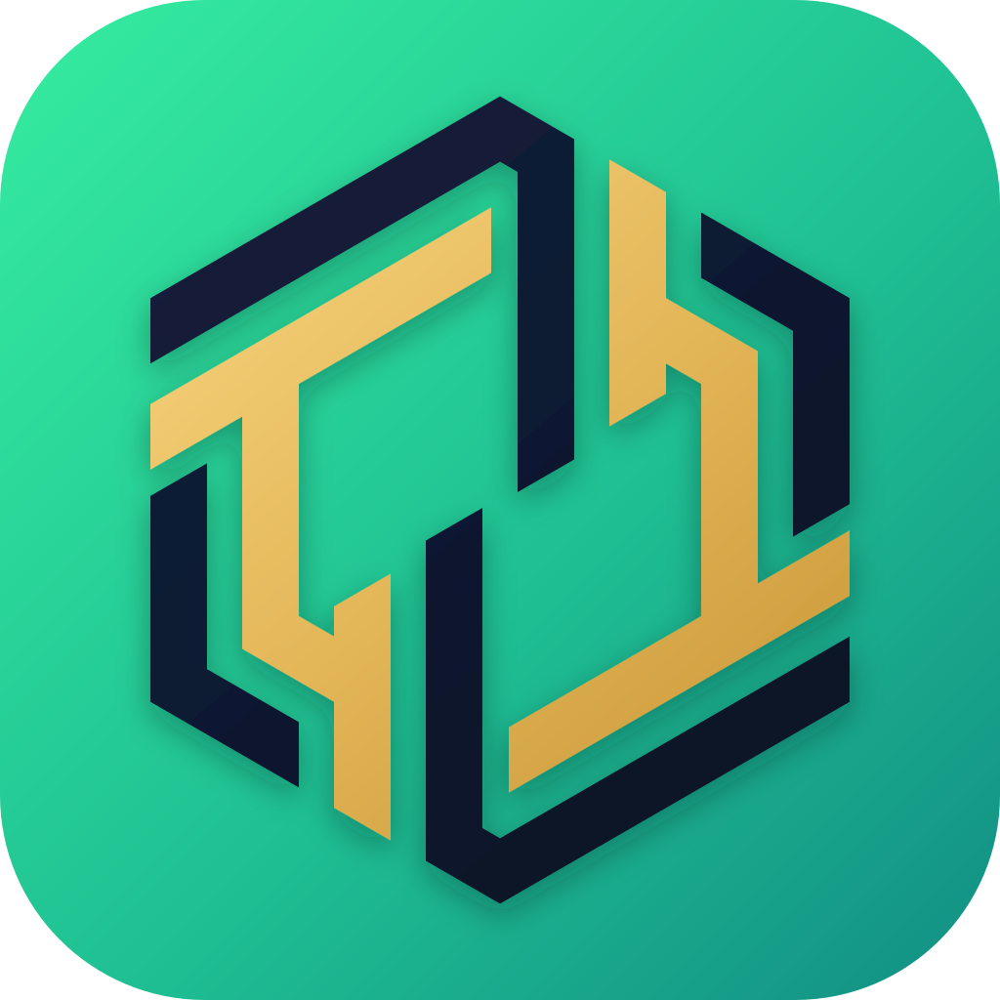
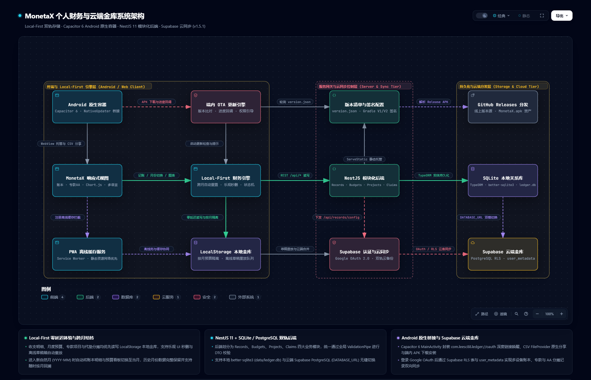

<div align="center">



# 🛡️ MonetaX

### Minimalist, Local-First Personal Finance & Private Cloud Vault
### 极简 · 本地优先 · 防窥私密 · 云端实时同步个人财务管理终端

**A high-performance, distraction-free personal finance & wealth vault built for Web & Android.**  
*Instant offline entry • 360° Anti-Peeking Privacy Mode (`👁️`) • Click-to-Edit transactions • End-to-end user isolation with Supabase RLS • Sinking Funds & Split Bill Claims • Visual analytics & budget monitoring.*

[](https://github.com/LEESC88/ledger/releases/latest)
[](https://github.com/LEESC88/ledger/actions)
[](https://opensource.org/licenses/MIT)
[](https://github.com/LEESC88/ledger/releases)

<br/>

[📱 **Download Latest Signed APK (`MonetaX.apk`)**](https://github.com/LEESC88/ledger/releases/latest/download/MonetaX.apk) • [📦 **All Releases (历史版本)**](https://github.com/LEESC88/ledger/releases) • [🇬🇧 **English Docs**](#-english-documentation) • [🇨🇳 **中文文档**](#-中文文档-chinese-documentation)

</div>

---

## 📱 Standalone Signed Android APK Download / 安卓正式签名版 APK 直接下载

Install and run **MonetaX** directly on your Android phone without needing to host or deploy any backend server:

* 🚀 **[Download Latest Signed Android APK (`MonetaX.apk`)](https://github.com/LEESC88/ledger/releases/latest/download/MonetaX.apk)**
* 📦 **[View Release Notes & Historical Versions](https://github.com/LEESC88/ledger/releases)**
* 🔐 **V1/V2 Production Keystore Signed**: Built via `assembleRelease` with production V1/V2 signature schemes for seamless installation and in-place upgrades.
* 🔄 **In-App Auto Update**: Check and install new versions on the fly directly inside **Settings ➔ Application Version ➔ Check & Update**.

---

## 🆕 What's New in v1.5.3 (0ms Instant Cold-Start Hydration & Launch Speedup)

* ⚡ **0ms Instant Cold-Start Hydration (`<16ms`)**: Eliminated the 1~2s blank loading latency when opening the application. The app immediately hydrates and paints the last active session's cached transactions, monthly summary metrics, sinking funds, and budget status synchronously from local storage on frame 0, before seamlessly revalidating with Supabase Cloud in the background.
* 🚀 **Native Standalone Mobile Network Bypass**: Automatically bypasses redundant local `/api/*` configuration probing when running inside the standalone Capacitor Android wrapper, eliminating network timeout penalties on cold launch.
* 🔢 **v1.5.2 Foundations**: Dynamic font-scaling engine (`fitKpiMiniValues`) ensuring full monetary values and decimals are 100% visible, plus refined mobile top header spacing.

---

<div id="english-documentation"></div>

## 🇬🇧 English Documentation

### ✨ Overview

**MonetaX** cuts through the noise of bloated commercial bookkeeping apps filled with credit promotions, social feeds, and intrusive trackers. It returns personal finance to its core: **speed, clarity, privacy, autonomy, and tactile joy**.

Built on a **Local-First + Direct Supabase Cloud (PostgreSQL)** architecture, MonetaX functions with 100% autonomy:
* **Offline / In-Flight**: Sub-millisecond instant record entry into an optimistic queue with `⚡ Draft` indicator.
* **Online**: Background two-way synchronization with Supabase PostgreSQL protected by Row-Level Security (RLS).
* **Native Feel**: Web Haptics mechanical vibrations, fluid bottom sheet drag physics, and smooth 150ms cross-fades.

---

### 🏗️ System Architecture

<div align="center">
  <a href="https://htmlpreview.github.io/?https://github.com/LEESC88/ledger/blob/master/docs/architecture.html" target="_blank" title="Click to open interactive architecture diagram / 点击查看交互式高清架构图">
    <picture>
      <source media="(prefers-color-scheme: dark)" srcset="docs/architecture-dark.png">
      <source media="(prefers-color-scheme: light)" srcset="docs/architecture-light.png">
      
    </picture>
  </a>
  <p>
    🔍 <b><a href="https://htmlpreview.github.io/?https://github.com/LEESC88/ledger/blob/master/docs/architecture.html" target="_blank">Click here to open the Fullscreen Interactive Architecture Viewer</a></b> • <b><a href="docs/architecture.html">Open Local HTML File</a></b>
  </p>
</div>

MonetaX follows a clean **Three-Tier Local-First + Dual-Track Persistence** architecture, designed for maximum resilience, sub-millisecond tactile responsiveness, and complete multi-tenant cloud isolation:

1. **Client Runtime & Local-First Engine Layer (终端与 Local-First 引擎层)**
   * **Android Native Shell (`Capacitor 6`)**: Native WebView wrapper with deep-link OAuth callback (`com.leesc88.ledger://oauth`), native CSV `FileProvider` share intent, and `NativeUpdater` in-app APK installer.
   * **In-App OTA Engine (`NativeUpdaterInterface`)**: Automated background version polling against `version.json`, real-time download percentage bridge, and package installer invocation.
   * **Responsive SPA UI (`Vanilla ES2022`)**: Lightweight `<3.8MB` zero-virtual-DOM single-page architecture featuring fluid drag physics, 360° Anti-Peeking privacy mode, Chart.js 4 visual analytics, and modular i18n (`zh-CN`, `en`, `ms`).
   * **Local-First Financial Engine**: Instant optimistic transaction CRUD, sub-`16ms` single-tap record deletion, and calendar month auto-rollover (`YYYY-MM`).
   * **PWA Service Worker & LocalStorage Vault**: Network-first asset delivery (`public/sw.js`) and resilient local vault with offline draft retry/replay queue.

2. **Server Gateway & Cloud Sync Control Layer (服务网关与云同步控制层)**
   * **Release Manifest & Signing**: `version.json` endpoint coupled with production V1/V2 keystore signatures.
   * **NestJS 11 Modular Backend**: RESTful APIs for `Records`, `Budgets`, `Projects` (Sinking Funds), and `Claims` (Split Bills) with global `ValidationPipe` enforcement.
   * **Supabase Auth & Cloud Sync Coordinator**: Google OAuth 2.0 PKCE authentication and bi-directional background sync coordinator.

3. **Storage & Cloud Distribution Tier (持久化与云端分发层)**
   * **GitHub Releases CDN**: Global fast CDN distribution for signed `MonetaX.apk` assets.
   * **Local SQLite Database**: Zero-config local persistence powered by `better-sqlite3` and TypeORM (`data/ledger.db`).
   * **Supabase Cloud Vault**: PostgreSQL with strict Row-Level Security (RLS) policies and tenant-isolated `user_metadata` cloud backups.

---

### 🌟 Key Features

#### 1. 📅 Daily Timeline Grouping
* **Sticky Date Headers**: Groups all transactions by day with a sticky calendar header displaying formatted date (e.g. `10月27日 周二` / `Tue, Oct 27`), `Today` / `Yesterday` badges, and daily income/expense summaries.
* **Instant Filtering & Search**: Instant filter by `All`, `Expense`, or `Income`, filter by payment channel, or perform instant text searches across notes and categories.

#### 2. 💳 Multi-Account & Asset Wallets (Accounts & Wallets)
* **Real-time Balance Tracking**: Supports four foundational payment channels:
  * 💵 **Cash**
  * 📱 **eWallet (Electronic Wallet)**
  * 🏦 **Bank Card**
  * 💳 **Credit Card**
* **Initial Capital & Net Worth**: Configure starting balances for each account and track your live consolidated **Net Worth**.

#### 3. 📊 Visual Analytics & Spending Trend
* **Monthly Budget Tracker**: Real-time spending progress bar with dynamic color alerts (`< 80% Normal` ➔ `80-100% Warning` ➔ `> 100% Deficit`).
* **High-Contrast Category Donut Chart**: Every category possesses a distinct, non-overlapping signature color (Dining Orange, Transport Sky Blue, Shopping Pink, Housing Gold, Entertainment Purple, Healthcare Red Coral, Subscriptions Cyan, Other Slate).
* **Daily Spending Trend Line / Area Chart**: Interactive trajectory showing daily expenses from day 1 to 31, highlighting the month's spending peak day.

#### 4. 🔥 Daily Recording Streak & Motivation Badges
* **Flame Pill (`🔥 7d`)**: Top bar streak counter tracking consecutive days of recording.
* **Badges Wall**: 5-tier unlockable milestone badges (`🌱 First Step`, `🥉 3-Day Spark`, `🥈 Week Hero`, `🥇 Habit Master`, `👑 Century Legend`).

#### 5. 📳 Tactile Haptic Micro-Interactions & Gestures
* **Web Haptics Feedback**: Crisp 10ms mechanical vibration on record save, tab switch, and transaction deletion.
* **Native Bottom Sheet**: Transaction modal features a physical drag handle with smooth pull-down swipe-to-dismiss gesture.
* **Tactile Button Press**: Global `:active` scale physics (`0.96`) and smooth 150ms page cross-fade transitions.

#### 6. 🎯 Sinking Funds & 👥 Split Bill Claims
* **Sinking Funds (专款专用)**: Set dedicated savings targets (e.g., Annual Travel, Car Maintenance, Tech Devices) with dual budgeting modes (`Budget Deduct` vs `Extra Target Fund`). Automatically track spent progress against reserved allocations and release remaining balances back to the active month's budget upon completion.
* **Split Bill Claims (代垫与报销)**: Itemize multi-person shared expenses and group activities with granular per-friend debt tracking, individual payment status toggling, and one-tap total settlements.
* **Triple-Layer Cloud Persistence**: Synchronized across Supabase PostgreSQL tables (`projects`, `claims`), Supabase Auth user metadata (`user_metadata`), and NestJS SQLite backend with tombstone-aware conflict resolution to prevent accidental overwrites or data loss upon refresh.

#### 7. ✏️ Click-to-Edit Transactions & 👁️ 360° Anti-Peeking Privacy Mode
* **One-Tap Transaction Editing**: Tap any transaction row in the timeline to open the pre-filled Edit Bottom Sheet. Modify transaction type, amount, category, payment account, date, or note with instant synchronization across Supabase Cloud (`records.update`), local offline queue, and NestJS SQLite (`PATCH /api/records/:id`).
* **360° Privacy Blur Shield (`👁️`)**: Toggle the header eye icon to instantly apply a `5.5px` Gaussian blur across all sensitive numbers and charts (KPIs, transaction amounts, daily totals, monthly budget figures, daily trend & category donut charts, sinking fund targets, and split bill claims). Hover or touch any blurred element to temporarily peek.

#### 8. 🛡️ Enterprise Security, Data Retention & CSV Export
* **Native Google OAuth 2.0**: Zero-port deep-link scheme (`com.leesc88.ledger://oauth`) with isolated account data.
* **Row-Level Security (RLS)**: Data isolation enforced at the PostgreSQL database level.
* **Flexible CSV Export & Native Android Sheet**: Export transactions for the current year or historical thresholds (1, 2, 3, or 5 years) directly via the native Android Share/Save sheet into your phone's File Manager.
* **Storage Protection**: Built-in 50,000 record capacity limit per user with visual warning badges to prevent cloud database exhaustion.

---

### 🛠️ Tech Stack & Specifications

| Dimension | Technologies |
| :--- | :--- |
| **Mobile Runtime** | Capacitor 6 Android, PWA Service Worker, Web App Manifest |
| **Frontend Architecture** | Modern Vanilla JavaScript (ES2022), CSS Variables, Container Queries |
| **Data Visualization** | Chart.js 4 (Doughnut breakdown + Line/Area Daily Trend) |
| **Cloud & Database** | Supabase (PostgreSQL 15+, Row-Level Security, Auth, Storage) |
| **Optional Backend** | NestJS (TypeScript), TypeORM, PostgreSQL (`pg`) / SQLite (`better-sqlite3`) |
| **CI / CD Pipeline** | GitHub Actions (Automated Gradle Build, Key Signing, GitHub Releases) |

---

### 🚀 Quick Start (Local Development)

#### Prerequisites
* **Node.js** >= 18.0.0
* **npm** >= 9.0.0
* *(Optional for Android build)* **Android Studio** & JDK 17+

#### 1. Clone & Install
```bash
git clone https://github.com/LEESC88/ledger.git
cd ledger
npm install
```

#### 2. Environment Configuration
Create a `.env` file in the root directory:
```env
PORT=3000
DATABASE_URL="postgresql://<user>:<password>@<host>:6543/postgres"
SUPABASE_URL="https://<your-project>.supabase.co"
SUPABASE_ANON_KEY="<your-anon-key>"
```

#### 3. Build & Run Local Server
```bash
# Compile NestJS server and verify frontend assets
npm run build

# Start production server
npm run start:prod
```
Access the application at `http://localhost:3000`.

#### 4. Build Android APK Locally (Optional)
```bash
# Sync web assets to Capacitor Android project
npx cap sync android

# Open project in Android Studio or build via Gradle
cd android
./gradlew assembleRelease
```

---

<div id="中文文档"></div>

## 🇨🇳 中文文档 (Chinese Documentation)

### 📖 目录
1. [项目愿景与设计哲学](#-1-项目愿景与设计哲学)
2. [系统技术架构与核心分层](#-2-系统技术架构与核心分层)
3. [核心功能与业务模块详解](#-3-核心功能与业务模块详解)
4. [数据库表结构与安全策略设计](#-4-数据库表结构与安全策略设计)
5. [交互设计与微动效体系](#-5-交互设计与微动效体系)
6. [本地快速上手与环境配置](#-6-本地快速上手与环境配置)
7. [常见问题解答 (FAQ)](#-7-常见问题解答-faq)

---

### 💡 1. 项目愿景与设计哲学

商业记账软件普遍存在严重痛点：**臃肿、开屏广告、贷款理财推销、记账需要多层点击、断网无法使用、用户数据被滥用挖掘**。

**LEDGER** 诞生于对个人财务记账本质的回归与纯粹追求：

* **⚡ 本地优先（Local-First）**：
  将数据控制权彻底还给用户。断网、弱网、飞行模式下记账零等待，毫秒级本地存盘并即时刷新统计；网络恢复后，后台事件队列静默且安全地完成云端双向增量同步。
* **🪶 零运行时冗余（Zero Framework Bloat）**：
  客户端采用纯粹的原生现代 JavaScript（ES2022）、现代 CSS 容器查询（Container Queries）与原生 Web 动画，拒绝庞大的虚拟 DOM 库。整体打包体积仅 3.8 MB，冷启动只需 200~300ms，在老旧机型上依然丝滑流畅。
* **🔒 银行级数据隔离（Privacy by Default）**：
  基于 Google OAuth 2.0 认证和 PostgreSQL 行级安全（Row-Level Security, RLS），在数据库物理底层实现跨租户隔离，任何人（包括匿名接口）无权访问他人财务隐私。
* **📱 顶级原生交互质感（Native Ergonomics）**：
  借助原生微震动（Web Haptics）、抽屉物理跟手拖拽（Bottom Sheet）、按键机械回弹和时间轴吸顶头，让网页核心的应用脱离平庸，媲美顶尖原生 App 的手感。

---

### 🏛️ 2. 系统技术架构与核心分层

<div align="center">
  <a href="https://htmlpreview.github.io/?https://github.com/LEESC88/ledger/blob/master/docs/architecture.html" target="_blank" title="点击查看交互式高清架构图 / Click to open interactive architecture diagram">
    <picture>
      <source media="(prefers-color-scheme: dark)" srcset="docs/architecture-dark.png">
      <source media="(prefers-color-scheme: light)" srcset="docs/architecture-light.png">
      
    </picture>
  </a>
  <p>
    🔍 <b><a href="https://htmlpreview.github.io/?https://github.com/LEESC88/ledger/blob/master/docs/architecture.html" target="_blank">点击此处全屏打开高清交互式架构图（支持节点点击溯源、引导视图与高亮）</a></b> • <b><a href="docs/architecture.html">查看本地 HTML 文件</a></b>
  </p>
</div>

MonetaX 整体遵循 **“三层拓扑 · 本地优先 · 存储双轨 · 零延迟交互”** 的生产级系统架构设计，经由 Archify 校验并深度映射至代码实现仓库：

#### 架构三层核心划分：
1. **终端与 Local-First 引擎层 (`Client Runtime`)**：
   * **Android 原生容器 (`Capacitor 6`)**：托管原生 WebView，封装 `com.leesc88.ledger://oauth` 深度链接唤醒、原生 CSV `FileProvider` 分享 Intent 及 `NativeUpdater` 原生安装器桥接。
   * **端内 OTA 更新引擎 (`NativeUpdaterInterface`)**：轮询 `version.json`，实时计算并回传 APK 下载百分比，智能引导 Android 8.0+ 未知应用安装权限。
   * **MonetaX 响应式视图 (`Vanilla ES2022`)**：轻量级 `<3.8MB` 单页应用，包含 `#pageLedger`、`#pageProjects`、`#pageAnalytics`、`#pageSettings` 四大视图、360° 防窥私密模式 (`👁️`)、Chart.js 4 图表与中/英/马三语字典。
   * **Local-First 财务引擎**：实现账单 CRUD、`<16ms` 乐观 UI 单击秒删、自然月跨月自动切换与重置（`YYYY-MM`）及离线重放状态机。
   * **PWA 离线缓存服务 & 本地金库**：`public/sw.js` 静态资源网络优先缓存，LocalStorage 按月隔离存储与离线草稿队列重放。

2. **服务网关与云同步控制层 (`Server & Sync Tier`)**：
   * **版本清单与签名配置**：`version.json` 客户端元数据分发与 Gradle V1/V2 签名体系。
   * **NestJS 11 模块化后端**：严格划分为 `Records`（账单）、`Budgets`（预算）、`Projects`（专款）、`Claims`（代垫分摊）四大模块，全局 `ValidationPipe` 强校验输入。
   * **Supabase 认证与云同步**：Google OAuth 2.0 PKCE 认证会话恢复与专款/代垫双向云端同步器。

3. **持久化与云端分发层 (`Storage & Cloud Tier`)**：
   * **GitHub Releases 分发**：全球 CDN 高速下发最新签名的 `MonetaX.apk` 安装包。
   * **SQLite 本地关系库**：基于 `better-sqlite3` 与 TypeORM 的本地 `data/ledger.db`，开箱即用。
   * **Supabase 云端金库**：托管于云端 PostgreSQL，采用行级安全策略（RLS）与 `user_metadata` 保障严格的多租户财务隐私隔离。

#### 技术选型亮点对比：

| 维度 | 传统混合记账 App | LEDGER 架构优势 |
| :--- | :--- | :--- |
| **前端框架** | React / Vue / Angular (打包体积 15MB+) | **Modern Vanilla JS** (打包体积仅 3.8MB，零虚拟 DOM 开销) |
| **网络模式** | Cloud-First (无网络时报红甚至无法进入) | **Local-First** (离线秒记，后台自动重试增量同步) |
| **手感体验** | 生硬网页点击，无物理反馈 | **Web Haptic API + 阻尼下压 + 拖拽手柄关闭** |
| **视觉体系** | 复杂低对比度报表，分类色彩单一混淆 | **8 种高对比度专属色彩心理学配色 + 粘性时间轴** |
| **数据安全** | 中心化明文或简单鉴权，存在数据泄露风险 | **PostgreSQL RLS 物理级行权限隔离** |

---

### 🧩 3. 核心功能与业务模块详解

#### 1. 按天时间轴分组账单（Daily Timeline Grouping）
* **视觉层级**：彻底摒弃无止境平铺的陈旧长列表，以天为单位构建消费时间轴。
* **粘性吸顶头（Sticky Date Header）**：
  * 显示清晰的日期与星期（例如 `10月27日 周二` 或 `Tue, Oct 27`）；
  * 自动标记 `今天 (Today)`、`昨天 (Yesterday)` 专属高亮胶囊；
  * 右侧实时汇总当天支出总额（`-RM 45.00`）与收入总额（`+RM 100.00`），每日财务健康一目了然。
* **卡片自适应容器**：在移动端屏幕（宽度 `< 600px`）通过 CSS 容器查询自动将传统表格平滑折叠为极简触控卡片。

#### 2. 多资产账户与资金池管理（Accounts & Wallets）
* **四维主流支付渠道**：
  * 💵 **现金 (Cash)**：日常零钱收支；
  * 📱 **电子钱包 (eWallet)**：覆盖各大扫码与在线移动支付；
  * 🏦 **银行卡 (Bank Card)**：储蓄卡流水与工资入账；
  * 💳 **信用卡 (Credit Card)**：信贷消费与账期管理。
* **初始资金与动态净资产**：
  * 支持为每个账户分别设定**初始资金（Initial Balance）**；
  * 结合历史所有收入与支出流水，实时动态推算各账户结余及**全盘总净资产（Net Worth）**。
  * 内置完全向后兼容逻辑，老账单历史数据平滑映射，绝不丢数据。

#### 3. 智能图表与当月开销走势分析（Analytics & Daily Trend）
* **月度总预算监控条（Monthly Budget Tracker）**：
  * 支持随时调整当月预算限额（如 RM 3,000）；
  * 动态进度条具有智能三段式警示变色：`< 80%` 健康常态、`80%~100%` 橙黄预警、`> 100%` 红色超支提示。
* **高对比度分类环形占比图（Donut Chart）**：
  * 告别同色系扎堆，为餐饮美食（暖橙 `#F97316`）、交通出行（蔚蓝 `#0EA5E9`）、购物消费（粉红 `#EC4899`）、居家水电（金黄 `#EAB308`）、休闲娱乐（靓紫 `#8B5CF6`）、医疗健康（红 `#EF4444`）、会员订阅（青蓝 `#06B6D4`）、其他杂项（板岩灰 `#64748B`）定义独立色彩。
* **每日开销走势面积图（Daily Spending Trend）**：
  * 横轴呈现当月 1 号至月末每天，纵轴直观反映支出金额起伏；
  * 自动定位并徽章标记当月消费**最高峰值日（Peak Day）**，周末狂欢或大额消费一清二楚。

#### 4. 连续记账打卡与成就徽章墙（Streak & Motivation Badges）
* **火焰打卡胶囊（Streak Counter）**：首页右上角显眼展示当前连续记账天数（如 `🔥 7d`），算法兼顾今天与昨天打卡锚点，断签自动判定。
* **5 阶成就徽章里程碑**：
  * 🌱 **初出茅庐 (First Step)**：完成第 1 笔记录；
  * 🥉 **三日星火 (3-Day Spark)**：连续记账满 3 天；
  * 🥈 **周常英雄 (Week Hero)**：连续记账满 7 天；
  * 🥇 **习惯大师 (Habit Master)**：连续记账满 30 天；
  * 👑 **百日传奇 (Century Legend)**：连续记账满 100 天。

#### 5. 原生下抽屉（Bottom Sheet）与记账弹窗
* 弹窗顶部设有深色/浅色自适应微型**拖拽手柄条（Drag Handle）**；
* 支持单手下滑超过 80px 触发阻尼跟手顺滑关闭；
* 内置金额快捷递增药丸（`+10`、`+20`、`+50`、`+100`、`Reset`）与九宫格大图标分类选择器。

#### 6. 专款储备（Sinking Funds）与 AA 制代垫报销（Split Bill Claims）
* **专项储备金（专款专用）**：
  * 支持为特定目标建立独立储蓄资金池（如汽车保养、年度旅游、数码设备采购）；
  * 双归集模式：**从当月预算扣除（Budget Deduct）** 或 **额外专款储备（Extra Target Fund）**；
  * 记账时可直接勾选关联专款，实时扣减储备进度；专款结项时支持一键将剩余款项**回滚释放至当月预算**。
* **AA 制代垫与报销管理**：
  * 多人聚餐、活动采购分账明细，精确记录每位好友应付金额及本人分摊；
  * 支持逐个好友标记「已结清」或一键「全额结清归档」。
* **三重云端持久化保障**：
  * **PostgreSQL 云端业务表**（`projects`、`claims` 表）实时读写；
  * **Supabase Auth 元数据自动备份**（`user_metadata` 跨设备即时同步）；
  * **NestJS SQLite 本地/服务端双向同步**，搭载墓碑防误删合并（Tombstone-aware Merge）与缺失自动回填，刷新零丢失。

#### 7. 历史归档、本年数据与 RFC 4180 CSV 导出
* **全周期与本年度导出**：支持即时导出**「📅 本年度账单」**及 1年、2年、3年、5年前的历史账单；
* **原生安卓文件管理器直存**：在手机端一键唤起系统分享与保存面板，可自由选择保存到本地任意目录；
* **容量防爆保护**：内置单用户 50,000 条记录容量限额与预警防护，有效防止云端数据库过载。

#### 8. 模块化多语言与外观主题
* **独立字典文件（[public/i18n.js](public/i18n.js)）**：中英文键值按业务模块严谨归类，支持中文与英文一秒无刷新热切换；
* **三模外观**：纯净高对比浅色（Light）、深邃蓝黑防眩晕深色（Dark）与跟随系统（System）。

#### 9. 账单点击编辑（Click-to-Edit）与 360° 防窥隐私模式（Privacy Mode）
* **点击流水直达编辑**：直接点击明细表中的任意一笔账单行，即可弹出预填充的编辑面板，自由修改收支类型、金额、分类、支付账户、日期与备注，并同步更新 Supabase 云端、本地离线草稿队列与 SQLite 数据库（`PATCH /api/records/:id`）。
* **360° 防窥隐私护盾（`👁️`）**：一键点击顶部导航栏眼睛图标，自动对全站所有敏感金额与图表施加 `5.5px` 高斯模糊（涵盖顶部 KPI、流水金额、每日小计、月度预算各项数值、趋势折线图、分类占比圆环图、专款卡片与代垫卡片），支持鼠标悬停或触屏点按临时透视查看，状态持久记忆。

---

### 🗄️ 4. 数据库表结构与安全策略设计

本项目采用 PostgreSQL 关系型结构构建，在 Supabase Cloud 上启用 **Row-Level Security (RLS)** 强制行安全隔离。

#### 核心数据表设计：

```sql
-- 1. 账单流水表 (records)
CREATE TABLE public.records (
    id BIGSERIAL PRIMARY KEY,
    user_id UUID NOT NULL REFERENCES auth.users(id) ON DELETE CASCADE,
    type VARCHAR(10) NOT NULL CHECK (type IN ('expense', 'income')),
    amount NUMERIC(10, 2) NOT NULL CHECK (amount > 0),
    category VARCHAR(50) NOT NULL,
    account_name VARCHAR(50) DEFAULT 'Cash',
    date DATE NOT NULL DEFAULT CURRENT_DATE,
    note TEXT DEFAULT '',
    created_at TIMESTAMPTZ DEFAULT NOW(),
    updated_at TIMESTAMPTZ DEFAULT NOW()
);

-- 2. 资产账户余额表 (accounts)
CREATE TABLE public.accounts (
    id BIGSERIAL PRIMARY KEY,
    user_id UUID NOT NULL REFERENCES auth.users(id) ON DELETE CASCADE,
    name VARCHAR(50) NOT NULL,
    initial_balance NUMERIC(10, 2) DEFAULT 0.00,
    created_at TIMESTAMPTZ DEFAULT NOW(),
    updated_at TIMESTAMPTZ DEFAULT NOW(),
    UNIQUE(user_id, name)
);

-- 3. 月度预算限额表 (budgets)
CREATE TABLE public.budgets (
    id BIGSERIAL PRIMARY KEY,
    user_id UUID NOT NULL REFERENCES auth.users(id) ON DELETE CASCADE,
    month VARCHAR(7) NOT NULL, -- 格式 'YYYY-MM'
    limit_amount NUMERIC(10, 2) NOT NULL CHECK (limit_amount >= 0),
    created_at TIMESTAMPTZ DEFAULT NOW(),
    updated_at TIMESTAMPTZ DEFAULT NOW(),
    UNIQUE(user_id, month)
);
```

#### RLS 行级安全规则（以 records 表为例）：
```sql
ALTER TABLE public.records ENABLE ROW LEVEL SECURITY;

-- 仅允许用户读写属于自己的账单
CREATE POLICY "Users can only access their own records"
ON public.records
FOR ALL
USING (auth.uid() = user_id)
WITH CHECK (auth.uid() = user_id);
```
> **安全保证**：任何客户端发起的数据库查询，PostgreSQL 都会首先核对当前 JWT 中的 `auth.uid()` 是否与数据行的 `user_id` 匹配。因此即使匿名公钥（`anonKey`）公开在前端，第三方也**绝不可能越权跨库查询其他用户的账单**。

---

### 🎛️ 5. 交互设计与微动效体系

为了提供媲美 iOS/Android 原生应用的精致感，LEDGER 建立了成套的物理触感与视觉反馈体系：

1. **机械触感震动（Web Haptics）**：
   - 采用标准 W3C Vibration API，封装为安全优雅的 `triggerHaptic(duration)`；
   - 切换底部导航（10ms）、点击保存记账（15ms）、滑动关闭弹窗（10ms）、删除账单（12ms）、切换收支筛选（8ms），均提供清脆、微弱但扎实的微机械触觉反馈。
2. **全局物理阻尼按压反馈（`:active` 缩放）**：
   - 针对所有操作按钮、导航 Tab、分类药丸和快捷金额胶囊应用了物理阻尼按压：
     ```css
     button:active:not(:disabled),
     .tab-btn:active,
     .segment-btn:active,
     .category-chip:active,
     .bottom-nav-item:active {
       transform: scale(0.96);
       transition: transform 60ms cubic-bezier(0.2, 0, 0, 1);
     }
     ```
   - 手指按下时有明显的弹性收缩，抬起时顺畅回弹。
3. **平滑淡入转场（Cross-fade Transitions）**：
   - 页面间切换并非僵硬的瞬间替换，而是加入 150ms 优雅透明度淡入淡出动效。

---

### 💻 6. 本地快速上手与环境配置

#### 环境前置准备：
- [Node.js](https://nodejs.org/) (推荐 LTS 18.x 或 20.x, 22.x)
- [Git](https://git-scm.com/)
- *(如需本地打包 APK)* 安装 [Android Studio](https://developer.android.com/studio) 及 JDK 17+

#### 步骤 1：克隆代码仓库
```bash
git clone https://github.com/LEESC88/ledger.git
cd ledger
npm install
```

#### 步骤 2：配置环境变量 (`.env`)
在项目根目录下创建或编辑 `.env` 文件：
```env
# 服务端端口 (默认为 3000)
PORT=3000

# PostgreSQL 数据库直连连接串 (来自 Supabase 数据库设置)
DATABASE_URL="postgresql://postgres.<project-ref>:<db-password>@aws-0-ap-northeast-1.pooler.supabase.com:6543/postgres"

# Supabase 项目 API 凭证 (来自 Supabase Project Settings -> API)
SUPABASE_URL="https://<your-project>.supabase.co"
SUPABASE_ANON_KEY="eyJhbGciOiJIUzI1NiIsInR5cCI6IkpXVCJ9..."
```

#### 步骤 3：启动本地全栈服务
```bash
# 编译 NestJS 后端与校验前端资源
npm run build

# 启动服务端 (生产模式)
npm run start:prod

# 或启动开发监听模式 (热重载)
npm run start:dev
```
在浏览器中打开 `http://localhost:3000` 即可开始使用。

#### 步骤 4：本地打包 Android APK（Capacitor 原生同步）
```bash
# 将 public/ 下所有最新 Web 前端资产同步至 Android 工程
npx cap sync android

# 方式 A：直接使用 Gradle 命令行编译生成 APK
cd android
./gradlew assembleRelease

# 方式 B：使用 Android Studio 打开工程并视窗化调试
npx cap open android
```
编译产物位于 `android/app/build/outputs/apk/release/app-release.apk`。

---

### ❓ 7. 常见问题解答 (FAQ)

#### Q1：我可以直接把导出的 APK 安装到手机上离线使用吗？
**完全可以**。LEDGER 采用 **Local-First** 架构，即使不连接任何云端网络、飞行模式下，所有记账、预算、图表和资产计算都可以在手机本地毫秒级完成。

#### Q2：如果不小心断网记账了，数据会丢失吗？
**绝不会丢失**。所有离线记录会自动保存在手机本地离线队列（标记为 `⚡`）。一旦检测到网络恢复连接，后台自动静默推送同步到 Supabase 云端。

#### Q3：换了新手机后，如何恢复以前的记账数据？
在新手机上打开 LEDGER，点击「使用 Google 账号登录」。登录成功后，云端存储的所有历史账单、资产账户与个人设置将在 1 秒内全量自动恢复同步到本机。

#### Q4：应用更新时需要去浏览器重新下载安装包吗？
**不需要**。当 GitHub 发布了新版本后，直接在手机 App 内进入【设置】页面，点击**「检查更新」**，应用内内置下载器会自动拉取新版本安装包并调起系统安装升级。

---

## 📄 开源许可证 (License)

本项目基于 **[MIT License](LICENSE)** 开源发布。  
你可以自由地使用、修改、分发与二次开发，欢迎提出 Issue 与 Pull Request！
